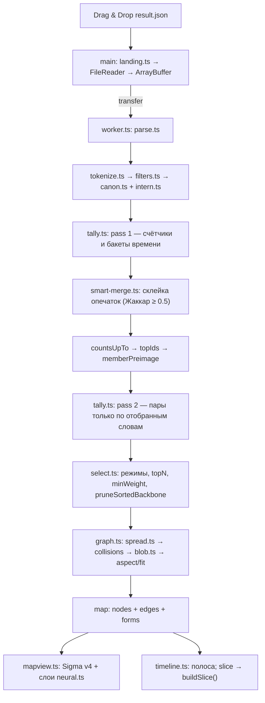

# ChatMap — Архитектура

> **Зачем документ:** единственный источник истины о том, как байты `result.json` превращаются в карту, и какие
> инварианты нельзя ломать. Всё ниже проверено по коду на **2026-11-23**; расхождения с кодом — баг документа.
> Preflight: `npm run typecheck && npm run test && npm run build` → 21 файл, 335 тестов.
> Историю решений и отвергнутые варианты держим в `specs/`, не здесь.

---

## 1. Что это

Локальный одностраничный инструмент: официальный JSON-экспорт Telegram-чата → граф совместной встречаемости слов.

- **Узлы** — нормализованные лексемы; радиус = частота (и длина слова на нижнем краю).
- **Рёбра** — совместное употребление: реплай, соседние сообщения, скользящее окно внутри сообщения.
- **Цвет** — преобладающий автор слова, hue-шаг золотого сечения `137.5° · i` (`src/core/geometry.ts`).
- **Приватность** — весь конвейер в Web Worker вкладки; сетевых вызовов в коде нет.

## 2. Инварианты (нарушение = регресс, не «стиль»)

| # | Инвариант | Где держится |
| --- | --- | --- |
| I1 | Ни одного сетевого запроса с данными чата: нет `fetch`, `XMLHttpRequest`, `WebSocket`. | проверка: `rg -n "fetch\\(|XMLHttpRequest|WebSocket" src` → пусто |
| I2 | Тяжёлое считается в воркере, main только рисует и слушает ввод. | `src/core/worker.ts`, `src/main.ts` |
| I3 | Раскладка детерминирована от `seed`; фильтр **не двигает** уже нарисованные узлы. | `src/core/graph.ts`, `src/core/spread.ts` |
| I4 | Реальный экспорт не попадает в git — только `tests/fixtures/sample-export.json`. | `.gitignore`, `tests/fixtures/` |
| I5 | Визуальная математика — чистые функции без DOM/WebGL, покрыты тестами. | `src/core/style-math.ts`, `src/core/geometry.ts` |

## 3. Контракт main ↔ worker (`src/core/types.ts`)

| Направление | Сообщение | Смысл |
| --- | --- | --- |
| → worker | `open { buf, seed? }` | `ArrayBuffer` передаётся transfer'ом (zero-copy), декод в воркере; `seed` пиннит раскладку |
| → worker | `update { cfg }` | `FilterCfg & ViewCfg`; кэши пайплайна переиспользуют стадии |
| → worker | `slice { bucket }` | [Query] один кадр таймлайна на закреплённой раскладке |
| → worker | `timelineOn` | [Command] метаданные полосы (бакеты, подписи, высоты тиков) |
| ← main | `progress`, `ready`, `warn`, `error` | стадии, авторы + число сообщений, мягкие предупреждения |
| ← main | `map` | `nodes`, `edges`, `maxCount`, `maxWeight`, `forms` |
| ← main | `slice`, `timelineMeta` | кадр таймлайна и раскладка полосы |

Воркер обслуживает **один** открытый чат и одно текущее состояние; `slice` читает последний `map` (`lastPinned`),
поэтому кадр таймлайна не может разойтись с нарисованным графом.

## 4. Пайплайн



Стадии и их кэш живут в `tally.ts` (`PipelineCache`, `filterCacheKey`, `mergeCacheKey`): переключение фильтра не
пересобирает токены, смена topN не пересчитывает пары. Позиции слов кэшируются по канонической форме
(LRU, `MAX_POS_CACHE = 2000` в `worker.ts`), поэтому новый чат начинается с пустого пространства имён
(`resetWorkerState`).

### 4.1. Разбор (`parse.ts`)

- Снимается UTF-8 BOM, обрезается `\uFEFF`; пустой/не-JSON файл даёт внятную ошибку формата.
- Форматы: одиночный чат `{ messages: [...] }` и полный экспорт `{ chats: { list: [{ messages }] } }`.
- Автор: `from` → `actor` → `from_id/actor_id` → `Участник N`.
- Дата: `date` (ISO) или `date_unixtime` (строкой или числом).
- Rich Text: рекурсивная склейка частей (`bold`, `link`, `mention`, `code`, ...) с жёстким потолком
  `MAX_FLATTEN_DEPTH = 100` — защита от самовложенных экспортов.

### 4.2. Лексика (`tokenize.ts`, `canon.ts`, `filters.ts`, `smart-merge.ts`)

- `tokenize` → `Tok { word, cls }`, классы `plain | tech | digits`; ссылки, коды и упоминания отсекаются по сущности.
- `canon` — компактный русский стеммер Портера + сворачивание растянутых повторов (`неееет → нет`).
- `filters` — стоп-слова, маски обсценной лексики, смех (`ахах`, `lmao`, `кскс`) + пользовательские правила
  в двух пространствах: точное слово и корень с суффиксом `-`.
- `smart-merge` — триграммный Жаккар `≥ 0.5` для слов длиной `≥ 6`, слияние только в более частотную форму.
- Словарей-лемматизаторов нет и не будет: зависимость не оправдана.

### 4.3. Связи (`tally.ts`)

Три уровня силы, слабее — нет ребра:

| Уровень | Условие | Вес |
| --- | --- | --- |
| 1 | явный реплай (`reply_to`) | `1.0` |
| 2 | соседние сообщения с разрывом `≤ 10 мин` (`ADJACENT_CLOSE_MS`) | `0.7` |
| 3 | слова в одном сообщении/юните: окно `WINDOW_SIZE = 4`, затухание `1/d` | `1.0 · 1/d` |

Между юнитами одного сообщения связь слабее: `INTER_UNIT_WEIGHT = 0.3`. `MAX_LINK_TOKENS = 200` на сообщение
держит худший случай линейным. Pass 1 пишет счётчики по временным бакетам (`BucketCounts`), pass 2 сканирует
только пары слов, попавших в выборку (`memberSet` — прообраз слитых корней), поэтому фильтр по topN не читает
весь чат заново.

### 4.4. Выборка (`select.ts`)

- Режимы: `together`, `author-<id>` (только один голос), `cross` (пересечения двух участников; скрывается, когда
  участников больше двух).
- Отсечение: `topN`, `minWeight`, затем `dropEdgelessNodes`.
- `pruneSortedBackbone(sorted, N, alpha = 0.05)`: до 2 сильнейших рёбер на узел + рёбра, значимые по Serrano
  disparity filter, бюджет `max(300, round(3.5 · N))`. Вход уже отсортирован по весу — сортировка здесь была бы
  лишней работой на каждом фильтре.

## 5. Раскладка и геометрия

Порядок в `graph.ts::layout` (все клиренсы выражены в экранных px, мир получается одним делением в конце):

1. **`spread.ts`** — группировка по портам, landmarks, мягкая аффинность (Dijkstra в `leaf.ts`), stress-солвер;
   работа идёт в полосе `LAYOUT_SCREEN_SPAN = 1300`, кадр `FRAME_ASPECT = 2.0`.
2. **`resolveCollisions` фаза 1** — без якоря: в плотной куче суммарная сила сокращается и якорь прибил бы
   узлы к упакованному старту навсегда.
3. **Сдерживание хвоста** (`containTail`) — радиальное сжатие хвоста без переупорядочивания: иначе десяток
   листьев на кромке сжимает всю ткань в комок при нормировке по bounding box.
4. **`resolveCollisions` фаза 2** — с якорем к расширенной раскладке: уточняются борозды, хабы встают.
5. **`blob.ts::blobOffset`** — fBm-варп силуэта (4 октавы, `EDGE_AMP 0.55`, `DOMAIN_AMP 0.06`, carve-поток);
   порты едут тем же полем, поэтому коридоры остаются приклеенными к зонам.
6. **Хвост + короткая релаксация** (`WARP_RELAX_PASSES`) — варп создаёт свежие перекрытия.
7. **`holdAspect(2.0)` + `fitToSpan`** — аспект по bounding box, затем перевод в мир.

Инкрементальный путь: при `cachedShare ≥ 0.65` и `!fullRun` вызывается `seatNewNodes` — кадр переиспользуется
дословно, новые слова садятся к кэшированным соседям, порты пересчитываются как центроиды **старых** координат.
Это и есть I3: переключатель фильтра не имеет права сдвинуть силуэт.

Размер и воздух (`geometry.ts`, `style-math.ts`):

- Радиус: `SIZE_MIN 2.8 + (SIZE_MAX 68 − 2.8) · q^0.62`, где `q = count / maxCount`; сжатие ядра выше 9 px — `0.72`.
  При вырожденном распределении частот (все слова равны) берётся text-fit радиус от длины слова — иначе иерархия
  врёт.
- Бюджет площади: `footprintScale` (`MAP_FOOTPRINT_PX2 = 170000`) пропорционально сжимает всё распределение, когда
  тела занимают слишком много полотна; порядок размеров сохраняется.
- LOD: ниже `LOD_GONE_PX = 1.6` нарисованного ядра тело исчезает целиком, ребро гаснет вместе с ним; слабое ребро
  возвращается с потолком `WEAK_EDGE_CAP = 0.16`. Полов прозрачности нет — они давали линии, ведущие в пустоту.
- Подписи: `labels.ts` раскладывает боксы детерминированно (сетка + приоритеты), плашка гаснет вместе с текстом.
  База `LABEL_FONT_PX = 20`, коэффициент `0.62…1.0` от размера тела: точка в 5 px не носит подпись хаба.
- Тайминги: `ENTER_MS 900 + ENTER_OFFSET_MS 900 = ENTER_TOTAL_MS 1800`, фаза узла — `phaseFor(id)`.

## 6. Рендеринг (`mapview.ts`, `mapStyles.ts`, `neural.ts`)

- **Sigma v4.0.4** держит камеру, подписи (SDF-атлас), пикинг и depth-порядок; `graphology` — контейнер графа.
- **Свои GLSL-слои** из `sigma/rendering` (`EdgeLayer`, `EdgePath`, `FragmentLayer`): сома-узлы и кубические
  тракты-аксоны в `neural.ts`; `neuralClock`/`u_time` двигают «капли» только у верхушки веера.
- Один и тот же шрифт (`Obel Mono`, self-hosted) в атласе подписей и в замере боксов — иначе подписи врут о себе.
- Эго-сеть: наведение и пин дают ярусы по рангу веса (`opacity = 0.10 + 0.90 · tier³`), затемнение фона на 78 %.
  Пин промоутится в `depth = 'topNodes'` категорно, без reprocess; `labelDepth` — константа для всех нод.
- `itemSizesReference: 'screen'`, `labelRenderedSizeThreshold: 0`, `labelDensity: 5`, поворот камеры выключен.
- Легенда — отдельный 2D-canvas (`core/legend.ts` + `ui/legend.ts`); экспорт PNG: `@sigma/export-image` →
  `composePhoto` подкладывает плашку и легенду, размер = размер канваса рендера (DPR-масштаб), не фиксированный.

## 7. Таймлайн (`timebuckets.ts`, `slice.ts`, `ui/timeline.ts`)

- Гранулярность по длине истории: календарные месяцы при `≥ 6` месяцев, недели при `≥ 14` дней, иначе полоса
  недоступна (`eligible: false`) — на трёх днях кривая шума, а не эволюция тем.
- `slice` не двигает координаты: кадр собирается на закреплённой раскладке; слова вне курсора просто не попадают
  в кадр. Кандидаты режима «пересечения» кэшируются по ключу конфигурации фильтра.
- Перетаскивание полосы не перезапускает прогресс и не пересчитывает токены — только чтение тёплого кэша.

## 8. Карта кода

| Слой | Модули |
| --- | --- |
| Вход и экраны | `src/main.ts` (landing → progress → map, dev-режим `?fixture=1`), `ui/landing.ts` (порог 200 МБ), `ui/progress.ts` |
| Оркестрация | `core/worker.ts` (протокол, пайплайн, кэш, `lastPinned`), `core/types.ts` (контракт сообщений) |
| Разбор и лексика | `core/parse.ts`, `core/tokenize.ts`, `core/canon.ts`, `core/intern.ts`, `core/filters.ts`, `core/smart-merge.ts` |
| Подсчёт и выборка | `core/tally.ts`, `core/select.ts`, `core/slice.ts`, `core/timebuckets.ts` |
| Раскладка | `core/graph.ts` (солвер, аспект, мир), `core/spread.ts` (группы/stress), `core/leaf.ts` (Dijkstra, soft-init, листовая ткань), `core/blob.ts` (fBm-варп) |
| Метрики и стиль | `core/geometry.ts` (размеры, веера, бандлы, LOD-порог), `core/style-math.ts` (чистая визуальная математика), `core/labels.ts` (боксы подписей), `core/legend.ts`, `core/escapeHtml.ts`, `core/labelOverrides.ts` |
| Рендер и UI | `ui/mapview.ts`, `ui/mapStyles.ts`, `ui/neural.ts`, `ui/subgraphHighlight.ts` (эго-затемнение), `ui/subgraphAnim.ts` (твины), `ui/nodepanel.ts` (пин, формы, оверрайд подписи), `ui/controls.ts` (режимы, фильтры, палитра), `ui/timeline.ts`, `ui/legend.ts` |
| Стили | `src/styles/tokens.css` (`@layer`, `oklch()`, dark), `base.css`, `map.css`, `fonts.css` |
| Тесты и стенды | `tests/*.test.ts` (21 файл, чистая логика `src/core/`), `tests/fixtures/`, `tools/inspect-export.js` (формат экспорта), `tools/shot-shape.mjs`, `tools/shot-edges.mjs`, `tools/e2e-headless.mjs` |
| История решений | `specs/` (планы, аудиты, вердикты), `specs/adr/`, `openwiki/` |

## 9. Команды

| Действие | Команда | Заметки |
| --- | --- | --- |
| Dev | `npm run dev` | `http://127.0.0.1:5173/`; `?fixture=1` грузит синтетическую фикстуру (только DEV) |
| Тесты | `npm run test` | vitest, только `src/core/`; UI проверяется стендами и глазами |
| Типы | `npm run typecheck` | `tsc --noEmit`, strict |
| Сборка | `npm run build` | Vite, статический бандл в `dist/` |
| Preflight | `npm run typecheck && npm run test && npm run build` | зелёный до следующей задачи, без исключений |

Требования: Node с поддержкой ESM и `ReadableStream` (см. `package.json`), Chromium/Firefox с WebGL2.

## 10. Бэклог (только реальные дыры)

1. **Восстановление после потери WebGL-контекста** — обработчика `webglcontextlost` нет; при перегрузке GPU карта
   остаётся пустым канвасом.
2. **Импорт списков стоп-слов/мата из файла** — сейчас есть только два инлайн-поля в `ui/controls.ts`.
3. **Сравнение двух чатов** — дифференциальный лексикон; требует второго пространства идентификаторов в воркере.

## 11. Проверка инвариантов

```sh
# I1: сетевых вызовов нет
rg -n "fetch\(|XMLHttpRequest|WebSocket" src && echo "FAIL: network call" || echo "ok"
# I5: визуальная математика покрыта тестами
rg -l "style-math" tests | wc -l          # ожидается ≥ 1
# I3: инкрементальный путь существует
rg -n "cachedShare|cachedShare >= 0\.65" src/core/graph.ts
# Кадр таймлайна строится на закреплённой раскладке
rg -n "lastPinned" src/core/worker.ts
# Полный гейт
npm run typecheck && npm run test && npm run build
```
