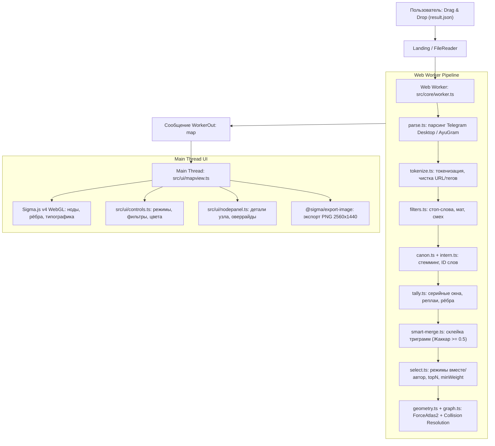

# ChatMap — Handoff Document

> Документ передачи контекста разработки проекта ChatMap.
> Дата актуализации: **10.11.2026**.
> Статус: **Все 13 этапов спецификации завершены, Preflight зелёный (192 теста passing, tsc 0 errors, build 0 errors)**.

---

## 1. Executive Summary

**ChatMap** — локальное клиентское одностраничное веб-приложение для интерактивного визуального анализа истории общения в Telegram. На основе официального JSON-экспорта чата формируется граф совместной встречаемости слов, где:
- **Узлы (Nodes):** нормализованные лексемы (размер пропорционален частоте слова в чате).
- **Рёбра (Edges):** факт и сила совместного употребления слов в рамках одного сообщения, серии сообщений (до 120 с) или ответа (reply).
- **Цвета (Colors):** преобладающий автор слова (золотое сечение шага hue $137.5^\circ \cdot i$).
- **Принцип приватности (Privacy First):** обработка данных происходит **строго локально** в браузере клиента в Web Worker. Ни один байт переписки или метаданных никогда не передаётся по сети.

---

## 2. Архитектура и Data Flow

Весь вычислительный пайплайн вынесен в Web Worker, что предотвращает блокировку интерфейса даже при обработке чатов на сотни тысяч сообщений. Главный поток отвечает только за отображение экранов, контролы и WebGL-рендеринг графа.

---

## 3. Ключевые инженерные решения и решённые проблемы

### 3.1. Универсальный парсинг JSON Telegram Desktop и AyuGram ([`parse.ts`](../src/core/parse.ts))
- **Удаление UTF-8 BOM:** файлы, сохранённые с `\uFEFF`, очищаются перед парсингом.
- **Поддержка форматов экспорта:**
  - Одиночный чат: объект с полем `messages: []`.
  - Полный экспорт аккаунта: структура `chats.list: [{ messages: [] }]`.
  - Извлечение реальных имён авторов из полей `from`, `actor` и `name`.
- **Нормализация дат:** бесшовная поддержка как ISO-строк (`2024-01-01T12:00:00`), так и целочисленного unixtime (`date_unixtime`).
- **Сложные текстовые сущности:** рекурсивное извлечение текста из Telegram Rich Text массивов (`type: bold`, `link`, `mention` и т.д.).

### 3.2. Лингвистический конвейер без внешних словарей ([`canon.ts`](../src/core/canon.ts), [`filters.ts`](../src/core/filters.ts))
- Реализован лаконичный русский стеммер Портера, оптимизированный под сетевой сленг.
- Сворачивание повторов букв (например, `неееет` $\to$ `нет`, `привеееет` $\to$ `привет`).
- Базовый встроенный словарь стоп-слов, масок обсценной лексики и смеха (`ахах`, `lmao`, `кскс`), с возможностью расширения через пользовательские токены.
- **Smart-merge:** склейка близких опечаток на базе триграммного сходства коэффициента Жаккара $\ge 0.5$ для слов длиной $\ge 6$ символов.

### 3.3. Физика графа и Backbone-фильтрация ([`graph.ts`](../src/core/graph.ts), [`worker.ts`](../src/core/worker.ts))
- **Backbone Pruning:** для исключения «спагетти» из случайных слабых связей, граф фильтруется по скелету: сохраняются до 4 сильнейших рёбер на каждый узел плюс все сильные магистрали с весом $w \ge 4$.
- **Весо-чувствительный ForceAtlas2:**
  - `edgeWeightInfluence: 1.4`: часто используемые вместе слова (включая реплаи) притягиваются в плотные смысловые кластеры, а редкие связи относятся на периферию.
  - `scalingRatio: 2800`, `gravity: 0.0004`: обеспечивают воздушную форму сети без сжатия в единый комок.
- **Экранно-зависимая релаксация коллизий (`resolveCollisions`):**
  - Алгоритм вычисляет масштаб координат графа относительно целевого вьюпорта (`scaleFactor = Math.max(1, span / 850)`).
  - Устраняет любые пересечения кругов нод, обеспечивая гарантированный визуальный зазор $\ge 10$ px между всеми телами узлов на экране.

### 3.4. Высококонтрастная типографика и WebGL-рендеринг ([`mapview.ts`](../src/ui/mapview.ts))
- **Экранные размеры узлов (`itemSizesReference: 'screen'`):** радиус нод задаётся в экранных пикселях ($5 \dots 45$ px), исключая зависимость видимости от нормализации координат.
- **Устранение скрытия текста:**
  - `labelRenderedSizeThreshold: 0`: подписи ключевых слов больше не отсекаются порогом размера при общем виде.
  - Зафиксирован постоянный размер шрифта `600 11.5px` — устранён эффект микротекста (2px) при отдалении камеры.
  - Сетка `labelDensity: 1.2` предотвращает наложение подписей друг на друга.
- **Адаптивное позиционирование подписей:**
  - Для крупных хабов ($\ge 18$ px): `labelPosition: 'over'`, контрастный тёмный текст `#0e1015` по центру пастельного кружка автора.
  - Для мелких узлов и сателлитов ($< 18$ px): `labelPosition: 'right'`, яркий белый текст `#f0f3ff` с полупрозрачной тёмной подложкой `#15171fe6`.
- **Культура подсветки эго-сети:**
  - При наведении (`enterNode`) активируются только **топ-8 сильнейших связей** слова.
  - Цвет активных связей — люминесцентный мягкий синий `#68a4ff` (2.2px) вместо ослепляющих белых лучей по всему экрану.
  - Неактивные связи и узлы затемняются (`#13141b20`), фокусируя внимание на контексте слова.
  - Отключено случайное вращение камеры (`enableCameraRotation: false`).

---

## 4. Карта кодовой базы

| Файл | Назначение |
|---|---|
| [`src/main.ts`](../src/main.ts) | Точка входа: роутинг экранов (landing $\to$ progress $\to$ map), инициализация UI и воркера, dev-режим `?fixture=1`. |
| [`src/core/worker.ts`](../src/core/worker.ts) | Оркестратор пайплайна в Web Worker: координация парсинга, токенизации, фильтрации, укладки и выборки. |
| [`src/core/parse.ts`](../src/core/parse.ts) | Декодер и валидатор JSON-экспорта Telegram / AyuGram. |
| [`src/core/tokenize.ts`](../src/core/tokenize.ts) | Извлечение слов, нормализация букв, классификация (`plain`, `tech`, `digits`). |
| [`src/core/canon.ts`](../src/core/canon.ts) | Стемминг русских и английских словоформ. |
| [`src/core/intern.ts`](../src/core/intern.ts) | Двунаправленное интернирование строковых токенов в компактные целочисленные ID. |
| [`src/core/filters.ts`](../src/core/filters.ts) | Проверка стоп-слов, эвристики мата и смеха. |
| [`src/core/tally.ts`](../src/core/tally.ts) | Подсчёт частот авторов и совместной встречаемости в окнах серий (до 120 с) и реплаях. |
| [`src/core/select.ts`](../src/core/select.ts) | Фильтрация подграфа: режимы «вместе», «только автор», «пересечения» двух участников, top-N, min-weight. |
| [`src/core/smart-merge.ts`](../src/core/smart-merge.ts) | Алгоритм триграммного Жаккара для объединения близких опечаток. |
| [`src/core/geometry.ts`](../src/core/geometry.ts) | Расчёт размеров нод (`nodeFitSize`), толщины (`edgeWidth`) и цветовой градации (`edgeColor`) рёбер. |
| [`src/core/graph.ts`](../src/core/graph.ts) | ForceAtlas2 укладка графа, детерминированный сид, `resolveCollisions`. |
| [`src/ui/landing.ts`](../src/ui/landing.ts) | Drag & Drop зона загрузки с валидацией размера ($>200$ МБ warning). |
| [`src/ui/progress.ts`](../src/ui/progress.ts) | Визуальный прогресс-бар стадий обработки в воркере. |
| [`src/ui/mapview.ts`](../src/ui/mapview.ts) | Sigma.js v4 WebGL канвас, управление камерой, эго-подсветка, экспорт в PNG. |
| [`src/ui/controls.ts`](../src/ui/controls.ts) | Выдвижная боковая панель настроек, фильтров и палитры цветов авторов. |
| [`src/ui/nodepanel.ts`](../src/ui/nodepanel.ts) | Правая карточка деталей пина: частота, топ-3 соседа, список словоформ, переопределение лейбла. |
| [`src/styles/`](../src/styles/) | CSS токены (`tokens.css`), базовые стили (`base.css`), стили карты и панелей (`map.css`). |
| [`tests/`](../tests/) | 14 тест-сьютов Vitest (192 юнит-теста) на все модули `src/core/`. |

---

## 5. Команды проекта и среда

Все команды выполняются из корня репозитория:

| Действие | Команда | Назначение |
|---|---|---|
| **Dev сервер** | `npm.cmd run dev` | Запуск локального сервера Vite на `http://127.0.0.1:5173/` |
| **Тестирование** | `npm.cmd run test` | Запуск 192 тестов Vitest для чистой логики `src/core/` |
| **Проверка типов** | `npm.cmd run typecheck` | Строгий аудит типов TypeScript (`tsc --noEmit`) |
| **Сборка** | `npm.cmd run build` | Компиляция оптимизированного продакшен-бандла в `dist/` |
| **Preflight** | `npm.cmd run typecheck && npm.cmd run test && npm.cmd run build` | Обязательный гейт перед любым коммитом |

> **Отладка визуализации без ручной загрузки файла:**  
> Откройте в браузере `http://127.0.0.1:5173/?fixture=1`. Приложение автоматически загрузит синтетическую фикстуру `tests/fixtures/sample-export.json` и сразу отрисует карту.

---

## 6. Базовые соглашения и «Never» правила

1. **Никакой отправки данных по сети:**
   - Категорически запрещён любой сетевой `fetch`/`xhr`/WebSocket, передающий токены, слова или идентификаторы чата. Работа строго автономная.
2. **Никаких реальных файлов переписки в Git:**
   - В тестах и репозитории используются только синтетические фикстуры ([`sample-export.json`](../tests/fixtures/sample-export.json)).
3. **Строгая эстетика интерфейса:**
   - Тёмная тема (`--paper: oklch(0.16 0.01 85)`).
   - Запрещены градиенты, декоративные тени, свечения, смайлики в интерфейсе и маркетинговый текст.
   - Телеграфный, лаконичный русский язык интерфейса.
4. **Минимализм зависимостей:**
   - Никаких тяжёлых UI-фреймворков (React/Vue/Svelte) — только чистый TypeScript.
   - Никаких серверных лемматизаторов или многомегабайтных словарных баз.

---

## 7. Бэклог и точки дальнейшего роста

При развитии проекта рекомендуются следующие шаги:
1. **Загрузка кастомных стоп-слов из файла:** добавить в `src/ui/controls.ts` возможность импортировать собственный `.txt`-список слов-исключений.
2. **Временная шкала (Timeline Slider):** добавить фильтрацию сообщений по диапазону дат для изучения эволюции тем чата по месяцам/годам.
3. **Сравнение двух чатов:** режим загрузки двух файлов экспорта с дифференциальным подсвечиванием уникального лексикона каждого чата.
4. **WebGL Context Loss Recovery:** добавить обработчик события `webglcontextlost` на канвасе для бесшовного восстановления рендера при перегрузке GPU.
