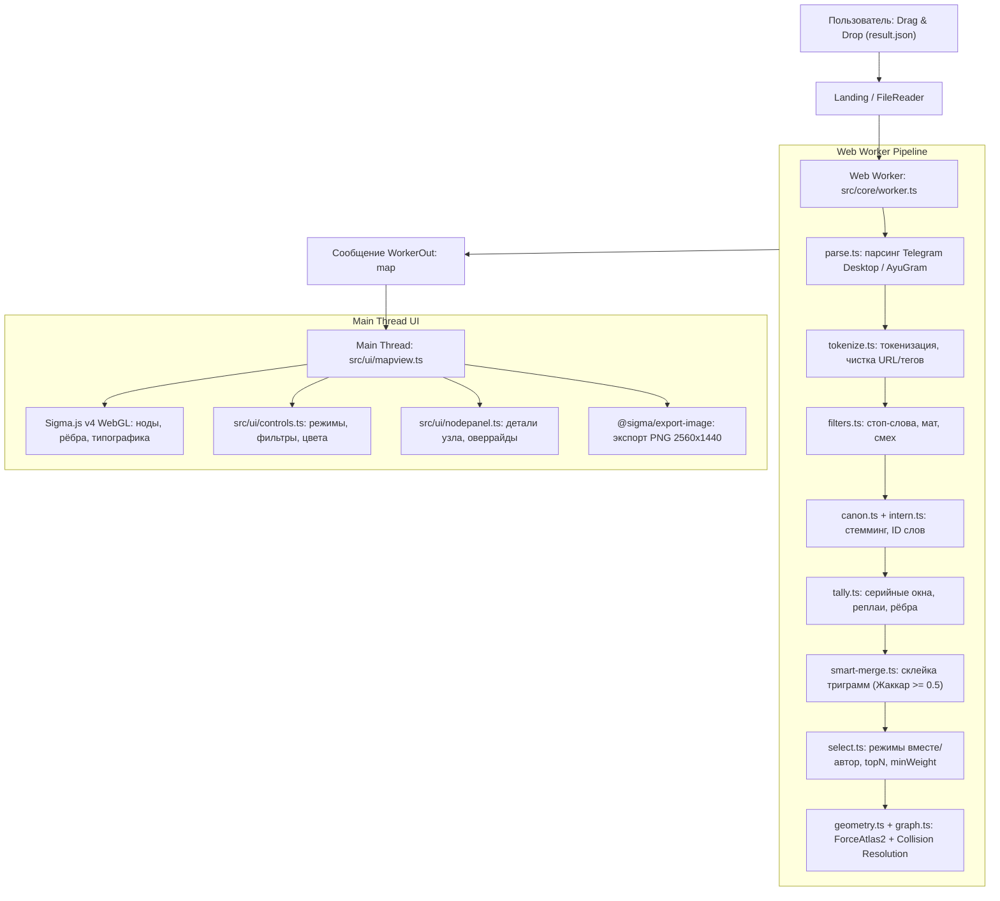

# ChatMap — Handoff Document

> Документ передачи контекста разработки проекта ChatMap.
> Дата актуализации: **12.11.2026**.
> Статус: **Preflight зелёный (239 тестов passing, 2 skipped, tsc 0 errors, build 0 errors)**.
> **Внимание:** правки сессии 2026-11-11/12 лежат в рабочем дереве и НЕ закоммичены
> (18 файлов, +1698/−300, 12 новых). Подробности, доказательства, живые константы и список
> проверенных тупиков — в [`HANDOFF_2026-11-12.md`](HANDOFF_2026-11-12.md).

---

## 1. Executive Summary

**ChatMap** — локальное клиентское одностраничное веб-приложение для интерактивного визуального анализа истории общения в Telegram. На основе официального JSON-экспорта чата формируется граф совместной встречаемости слов, где:
- **Узлы (Nodes):** нормализованные лексемы (размер пропорционален частоте слова в чате).
- **Рёбра (Edges):** факт и сила совместного употребления слов в рамках одного сообщения, серии сообщений (до 120 с) или ответа (reply).
- **Цвета (Colors):** преобладающий автор слова (золотое сечение шага hue $137.5^\circ \cdot i$).
- **Принцип приватности (Privacy First):** обработка данных происходит **строго локально** в браузере клиента в Web Worker. Ни один байт переписки или метаданных никогда не передаётся по сети.

---

## 2. Архитектура и Data Flow

Весь вычислительный пайплайн вынесен в Web Worker, что предотвращает блокировку интерфейса даже при обработке чатов на сотни тысяч сообщений. Главный поток отвечает только за отображение экранов, контролы и WebGL-рендеринг графа.

---

## 3. Ключевые инженерные решения и решённые проблемы

### 3.1. Универсальный парсинг JSON Telegram Desktop и AyuGram ([`parse.ts`](../src/core/parse.ts))
- **Удаление UTF-8 BOM:** файлы, сохранённые с `\uFEFF`, очищаются перед парсингом.
- **Поддержка форматов экспорта:**
  - Одиночный чат: объект с полем `messages: []`.
  - Полный экспорт аккаунта: структура `chats.list: [{ messages: [] }]`.
  - Извлечение реальных имён авторов из полей `from`, `actor` и `name`.
- **Нормализация дат:** бесшовная поддержка как ISO-строк (`2024-01-01T12:00:00`), так и целочисленного unixtime (`date_unixtime`).
- **Сложные текстовые сущности:** рекурсивное извлечение текста из Telegram Rich Text массивов (`type: bold`, `link`, `mention` и т.д.).

### 3.2. Лингвистический конвейер без внешних словарей ([`canon.ts`](../src/core/canon.ts), [`filters.ts`](../src/core/filters.ts))
- Реализован лаконичный русский стеммер Портера, оптимизированный под сетевой сленг.
- Сворачивание повторов букв (например, `неееет` $\to$ `нет`, `привеееет` $\to$ `привет`).
- Базовый встроенный словарь стоп-слов, масок обсценной лексики и смеха (`ахах`, `lmao`, `кскс`), с возможностью расширения через пользовательские токены.
- **Smart-merge:** склейка близких опечаток на базе триграммного сходства коэффициента Жаккара $\ge 0.5$ для слов длиной $\ge 6$ символов.

### 3.3. Физика графа и Backbone-фильтрация ([`graph.ts`](../src/core/graph.ts), [`worker.ts`](../src/core/worker.ts))
- **Backbone Pruning:** для исключения «спагетти» из случайных слабых связей, граф фильтруется по скелету (`pruneSortedBackbone`, вход уже отсортирован по весу): до 2 сильнейших рёбер на узел плюс рёбра, значимые по Serrano disparity filter ($\alpha = 0.05$), бюджет $\max(300, 3.5 \cdot N)$ рёбер.
- **Весо-чувствительный ForceAtlas2 (1200 итераций на полном прогоне, 20 на инкрементальном):**
  - `edgeWeightInfluence: 1.8`: часто используемые вместе слова (включая реплаи) притягиваются в плотные смысловые кластеры, а редкие связи относятся на периферию.
  - `linLogMode` включается с 12 узлов: лог-притяжение разделяет сообщества на гангии с перемычками; на крошечных графах ломает инвариант «сильная связь ближе».
  - `scalingRatio: 16000`, `gravity: 0.0003`: воздушная форма сети без сжатия в единый комок.
- **Релаксация коллизий (`resolveCollisions`):**
  - Зазор задаётся в **экранных** px и переводится в мировые единицы тем же коэффициентом, что и позиции: `pxToWorld = targetSpan / 1300`, зазор `5 px`, `scaleFactor = min(10, pxToWorld)`. Абсолютный зазор `max(84, size·1.95+28)` мировых единиц насыщал ограничение `dist >= ra+rb` на плотных картах, и решатель складывал карту в равномерную решётку (замер: Clark-Evans 0.99 при 1000 узлах = равномерный шум).
  - Прямой парный скан: на продовых зазорах он в 7–38 раз быстрее равномерной сетки, которая окупается только около 4500 узлов. Бюджет проходов: полный прогон — `max(iterationsForCount, 180/140)` (для >400 узлов — `iterationsForCount·2`), обновление фильтра — 12 проходов на переиспользованном кадре.
  - **Обновление фильтра не перестраивает карту:** при ≥60 % кэшированных координат кадр переиспользуется дословно (без FA2 и без повторной нормировки), а новые слова садятся на кольцо ~одного локального шага от кэшированных соседей. Раньше повторная нормировка бокса подмножества и 20 итераций FA2 по подграфу сдвигали узлы на 49 % спана (p90), и любой переключатель фильтра разрушал силуэт.

### 3.4. Высококонтрастная типографика и WebGL-рендеринг ([`mapview.ts`](../src/ui/mapview.ts))- **Экранные размеры узлов (`itemSizesReference: 'screen'`):** радиус нод задаётся в экранных пикселях ($5 \dots 45$ px), исключая зависимость видимости от нормализации координат.
- **Устранение скрытия текста:**
  - `labelRenderedSizeThreshold: 0`: подписи ключевых слов больше не отсекаются порогом размера при общем виде.
  - Зафиксирован постоянный размер шрифта `600 11.5px` — устранён эффект микротекста (2px) при отдалении камеры.
  - Сетка `labelDensity: 1.2` предотвращает наложение подписей друг на друга.
- **Адаптивное позиционирование подписей:**
  - Для крупных хабов ($\ge 18$ px): `labelPosition: 'over'`, контрастный тёмный текст `#0e1015` по центру пастельного кружка автора.
  - Для мелких узлов и сателлитов ($< 18$ px): `labelPosition: 'right'`, яркий белый текст `#f0f3ff` с полупрозрачной тёмной подложкой `#15171fe6`.
- **Культура подсветки эго-сети:**
  - При наведении (`enterNode`) активируются только **топ-8 сильнейших связей** слова.
  - Цвет активных связей — люминесцентный мягкий синий `#68a4ff` (2.2px) вместо ослепляющих белых лучей по всему экрану.
  - Неактивные связи и узлы затемняются (`#13141b20`), фокусируя внимание на контексте слова.
  - Отключено случайное вращение камеры (`enableCameraRotation: false`).

---

### 3.5. Иерархия размеров, LOD и фокус ([`geometry.ts`](../src/core/geometry.ts), [`mapStyles.ts`](../src/ui/mapStyles.ts))
- **Закон размеров:** радиус = `2.8 + 73.2 · q^0.85`, где `q = count / maxCount`. Три полосы по
  лог-нормировке (было) клали 90 % слов в одну полосу 5–8 px, и иерархия не доживала до экрана;
  степенной закон даёт контраст самого частого слова к самому редкому ≈ 25× по радиусу.
  Крутой показатель здесь не косметика: при плоской кривой тела вырастают настолько, что воздух
  между ними приходится съедать, чтобы уместиться в плоскость, и карта снова вырождается в решётку.
  `visualCoreRadius` сжимает выше 9 px в 0.72 (было 0.46).
- **Воздух между телами:** резерв под коллизию = тело + воздух, `air = max(2.5, 0.6·size)` px плюс
  детерминированная вариация ±40 % на ноду. Пропорциональность держит видимое отношение
  зазор/диаметр постоянным на карте любого размера; вариация ломает «бусы» из равноудалённых колец.
- **Кольцо — язык крупного слова:** орбита, бусинки и тики включаются только с 14–16 px ядра.
  У мелких нод остаётся звезда с аурой: плотное поле звёзд читается как пыль, плотное поле колец —
  как сцепленные звенья.
- **Бюджет площади:** `footprintScale` (`MAP_FOOTPRINT_PX2 = 170 000`) равномерно сжимает всё
  распределение, когда тела перекрывают больше ~14 % полотна: 1000 тел по 15 px не оставляют места
  ни сгусткам, ни пустотам. Иерархия при этом сохраняется (проверено тестом).
- **LOD:** потолок `lodBoost = 1.3` (было 2.63 при 1000 узлах), рампа плотности `(order−50)/550`,
  сжатие пыли 0.62. Полы прозрачности удалены (были 28 % у ноды и 10 % у ребра): ниже окна
  `lodPresence` (1.6…4.5 px нарисованного ядра) тело исчезает целиком, а ребро гаснет вместе с ним —
  иначе сотни линий вели в пустоту (замер: 1011 из 1272 на ratio 1.6 → 0). При приближении ребро
  возвращается с потолком `weakEdgeCap = 0.16`, поэтому связь читается как слабая.
- **Раскладка: доли и фрактальный шум.** После FA2 и контура карта разбивается на доли вокруг
  сильнейших хабов (`scatterLobes`), доля не может превысить 1.6× среднего (`balanceLobes` — иначе
  один мега-хаб собирает 85 % слов в один диск), затем `fractalScatter` рвёт разреженные области
  многооктавным смещением с весом по полю плотности. Замер: `clarkEvans` 1.28 → 0.84/1.05/1.10
  на 271/600/1000 нод. Все три механизма (воздух, сильнее градиент, сектора-впадины) проверены и
  не работают — разбор в `specs/2026-11-12-neural-lobes.md`.
- **Фокус = весь веер связей, ярусами по весу:** наведение подсвечивает ВСЕ инцидентные рёбра,
  ярус = ранг веса внутри веера (`1 − rank/n`): `opacity = 0.10 + 0.90·tier³`, толщина
  `+45·tier %`, бегущие капли только у верхушки (`tier ≥ 0.94`). Слабые связи остаются тусклыми,
  но заметно ярче фона, поэтому число связей читается. Соседи получают состояние `isEgo`
  (полная яркость, без принудительной подписи); подписи остаются бюджетом типографики —
  8 на hover, 12 на пин, и ранжируются «сначала в кадре, потом по весу» (`MapView.inFrameTest`).
  Связи вне веера затемняются на 78 %, а не на 93 %: фоновая сетка должна оставаться видимой.
- **Подписи и depth-бакеты:** `labelDepth` — константа `'topNodes'` для ВСЕХ нод. Sigma
  пересобирает буфер подписей на каждый depth-проход, поэтому разнесение подписей по двум бакетам
  (пин в `topNodes`, остальные в `nodes`) молча убирает из пикселей весь проход `nodes`: 54 подписи
  «отображаются» с alpha 1.0 и не рисуются. Промоушен `depth` остаётся только у тела пина.
  Плашка подписи гаснет вместе с текстом (`plateAlphaFor`), иначе получается пустая рамка.
- **Стабильность подписей:** раскладка подписей больше не читает применённое display-состояние
  (это была замкнутая петля `layout → display → layout`); видимая на прошлом кадре подпись держит
  слот (зазор ×0.35, приоритет +20), а гаснущие по LOD подписи не занимают слот
  (`labelIsLegible`, alpha > 0.25). Замер: подписей с повторными переключениями при отдалении
  стало 16 из 250 вместо 60.
- **Фокус:** пин переносит узел в последний depth-бакет Sigma (`depth`/`labelDepth = 'topNodes'`):
  его тело рисуется после всех тел, подпись — после всех подписей. Перенос категориальный (без
  reprocess остального графа), а «подъём» анимируется твином `promote` (0→1 за 220 мс, размер ×1.3,
  glow +0.5); при снятии — 160 мс назад.
- **Вход карты:** 1800 мс (`ENTER_MS 900` + `ENTER_OFFSET_MS 900`), каждый узел стартует на своём
  оффсете `phase · 900 мс` и растёт из 0.55 размера. Квантование твина для `enter` — 1/240, для
  остальных полей — 1/40. Обновление фильтра вход не перезапускает.
- **Сглаживание:** `antiAliasingFeather: 1.3`, feather SDF-тела волокна 0.55 px, кромка диска
  `−0.7…0.85 px`.

## 4. Карта кодовой базы

| Файл | Назначение |
|---|---|
| [`src/main.ts`](../src/main.ts) | Точка входа: роутинг экранов (landing $\to$ progress $\to$ map), инициализация UI и воркера, dev-режим `?fixture=1`. |
| [`src/core/worker.ts`](../src/core/worker.ts) | Оркестратор пайплайна в Web Worker: координация парсинга, токенизации, фильтрации, укладки и выборки. |
| [`src/core/parse.ts`](../src/core/parse.ts) | Декодер и валидатор JSON-экспорта Telegram / AyuGram. |
| [`src/core/tokenize.ts`](../src/core/tokenize.ts) | Извлечение слов, нормализация букв, классификация (`plain`, `tech`, `digits`). |
| [`src/core/canon.ts`](../src/core/canon.ts) | Стемминг русских и английских словоформ. |
| [`src/core/intern.ts`](../src/core/intern.ts) | Двунаправленное интернирование строковых токенов в компактные целочисленные ID. |
| [`src/core/filters.ts`](../src/core/filters.ts) | Проверка стоп-слов, эвристики мата и смеха. |
| [`src/core/tally.ts`](../src/core/tally.ts) | Подсчёт частот авторов и совместной встречаемости в окнах серий (до 120 с) и реплаях. |
| [`src/core/select.ts`](../src/core/select.ts) | Фильтрация подграфа: режимы «вместе», «только автор», «пересечения» двух участников, top-N, min-weight. |
| [`src/core/smart-merge.ts`](../src/core/smart-merge.ts) | Алгоритм триграммного Жаккара для объединения близких опечаток. |
| [`src/core/geometry.ts`](../src/core/geometry.ts) | Расчёт размеров нод (`nodeFitSize`), толщины (`edgeWidth`) и цветовой градации (`edgeColor`) рёбер. |
| [`src/core/graph.ts`](../src/core/graph.ts) | ForceAtlas2 укладка графа, детерминированный сид, `resolveCollisions`. |
| [`src/ui/landing.ts`](../src/ui/landing.ts) | Drag & Drop зона загрузки с валидацией размера ($>200$ МБ warning). |
| [`src/ui/progress.ts`](../src/ui/progress.ts) | Визуальный прогресс-бар стадий обработки в воркере. |
| [`src/ui/mapview.ts`](../src/ui/mapview.ts) | Sigma.js v4 WebGL канвас, управление камерой, эго-подсветка, экспорт в PNG. |
| [`src/ui/controls.ts`](../src/ui/controls.ts) | Выдвижная боковая панель настроек, фильтров и палитры цветов авторов. |
| [`src/ui/nodepanel.ts`](../src/ui/nodepanel.ts) | Правая карточка деталей пина: частота, топ-3 соседа, список словоформ, переопределение лейбла. |
| [`src/styles/`](../src/styles/) | CSS токены (`tokens.css`), базовые стили (`base.css`), стили карты и панелей (`map.css`). |
| [`tests/`](../tests/) | 16 тест-сьютов Vitest (239 юнит-тестов) на все модули `src/core/`; бенч-файлы `bench-tmp*` в счёт не входят и по умолчанию пропускаются. |
| [`tools/shot-shape.mjs`](../tools/shot-shape.mjs) | Локальный стенд визуальной проверки: синтетический чат → `#file-input` → `topN` → скриншоты + метрики формы. Зонды: `metrics`, `pin`, `enter`, `filter`, `sweep`, `census`, `flicker`, `lod`, `gaps`, `fan`. **Вне git** — решить, коммитить или удалять. |

---

## 5. Команды проекта и среда

Все команды выполняются из корня репозитория:

| Действие | Команда | Назначение |
|---|---|---|
| **Dev сервер** | `npm.cmd run dev` | Запуск локального сервера Vite на `http://127.0.0.1:5173/` |
| **Тестирование** | `npm.cmd run test` | Запуск 217 тестов Vitest для чистой логики `src/core/` |
| **Проверка типов** | `npm.cmd run typecheck` | Строгий аудит типов TypeScript (`tsc --noEmit`) |
| **Сборка** | `npm.cmd run build` | Компиляция оптимизированного продакшен-бандла в `dist/` |
| **Preflight** | `npm.cmd run typecheck && npm.cmd run test && npm.cmd run build` | Обязательный гейт перед любым коммитом |

> **Отладка визуализации без ручной загрузки файла:**  
> Откройте в браузере `http://127.0.0.1:5173/?fixture=1`. Приложение автоматически загрузит синтетическую фикстуру `tests/fixtures/sample-export.json` и сразу отрисует карту.

---

## 6. Базовые соглашения и «Never» правила

1. **Никакой отправки данных по сети:**
   - Категорически запрещён любой сетевой `fetch`/`xhr`/WebSocket, передающий токены, слова или идентификаторы чата. Работа строго автономная.
2. **Никаких реальных файлов переписки в Git:**
   - В тестах и репозитории используются только синтетические фикстуры ([`sample-export.json`](../tests/fixtures/sample-export.json)).
3. **Строгая эстетика интерфейса:**
   - Тёмная тема (`--paper: oklch(0.16 0.01 85)`).
   - Запрещены градиенты, декоративные тени, свечения, смайлики в интерфейсе и маркетинговый текст.
   - Телеграфный, лаконичный русский язык интерфейса.
4. **Минимализм зависимостей:**
   - Никаких тяжёлых UI-фреймворков (React/Vue/Svelte) — только чистый TypeScript.
   - Никаких серверных лемматизаторов или многомегабайтных словарных баз.

---

## 7. Бэклог и точки дальнейшего роста

При развитии проекта рекомендуются следующие шаги:
1. **Загрузка кастомных стоп-слов из файла:** добавить в `src/ui/controls.ts` возможность импортировать собственный `.txt`-список слов-исключений.
2. **Временная шкала (Timeline Slider):** добавить фильтрацию сообщений по диапазону дат для изучения эволюции тем чата по месяцам/годам.
3. **Сравнение двух чатов:** режим загрузки двух файлов экспорта с дифференциальным подсвечиванием уникального лексикона каждого чата.
4. **WebGL Context Loss Recovery:** добавить обработчик события `webglcontextlost` на канвасе для бесшовного восстановления рендера при перегрузке GPU.
